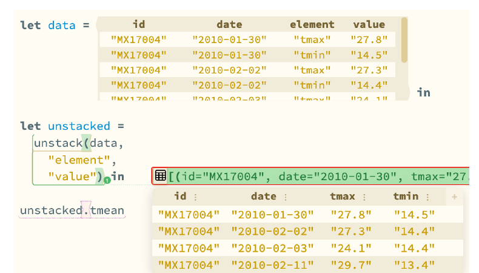

Most data analysis happens in dynamic languages like **Python**, **R**, **MATLAB**, and **Julia**
using computational notebook interfaces like **Jupyter** and **R Studio**.

These are flexible systems, but dynamic checking leaves critical information about 
*table schemas*, i.e. a table's column names and corresponding types,
completely latent in the operations that are performed.

Knowing the schema of a table generated during a calculation is useful for 
several reasons. It allows your editor (even when used by an AI) to provide more accurate autocomplete and 
error localization, often before you waste your time running an expensive 
but incorrect computation.

Making schemas explicit, e.g. at function and module boundaries, is also critical to 
interoperability and reuse, key concerns as scientific
work scales up to planetary scale (see our [FAIR case for a live computational commons](:2025-fair-commons-propl)).

Shifting to a statically typed approach could help matters, with table schemas tracked as types.
However, there is **a major problem with statically typed systems for working with tables**: they struggle with 
**data-dependent operations** where the schema of a function's output depends on the values in its input. 

For example, 
unstacking a long table into a wide one like in the example below produces a table whose column names and types
depend
on the values (here, in the "element" column) of the input! No ordinary static type checker can encode the type of this kind of operation 
precisely.

In [Interactive Data Analysis with Lively Typed Tables](:2026-typed-tables-oopsla),
which [Alexander Bandukwala](https://bandukwala.me/) presented at OOPSLA 2026, we take a different
approach in [Hazel](:hazel):

- **Tables are semantically just lists of labeled tuples**, with a few gradually typed
  operations (where the type is left statically unknown) for working with columns as strings. 
- **Live typing** feeds the types Hazel observes while running your program back
  into the static type checker. Because Hazel is live and keeps running programs even when they
  have holes and errors, it can report that a column produced by an unstack
  doesn't exist right where you access it, before you edit (or evaluate) further (e.g. in the example above, there is an error on the incorrect projection of `tmean`).

This is a straightforward approach, but it works beautifully!

Going further, we build a number of *direct manipulation editing* tools for working with tables directly into Hazel as well, so you can do exploratory data analysis directly in Hazel and, unlike in tools like spreadsheets, encode the manipulations you performed as reusable and modifiable code.

 The column header menu for Year suggests type conversions based on the live type of the table. (b) Each choice is written back into the program as code.")

The paper evaluates the overall Hazel design against the [Brown Benchmark for Table Types](https://github.com/brownplt/B2T2),
where Hazel expresses every example, and in a lab study with seven
participants doing data cleaning and analysis. People liked it!

You can try tables in Hazel
today (see the tables tutorial from the dropdown at the top, and the Tables page in the documentation at
[hazel.org/build/dev](https://hazel.org/build/dev/)). There is a 
[recording of the talk (14m)](https://www.youtube.com/watch?v=aCbrzAnBEbM) where Alexander gives several nice live demos of these ideas.

**During my sabbatical in Cambridge**, I hope to try porting more sophisticated data analyses from folks working in climate modeling of all sorts 
into this system and continue scaling it up until the point where Hazel really is a better tool overall for this kind of work than existing
systems. We've got a ways to go with performance but based on our lab study, we think we're quite close on the UI and semantics front!

